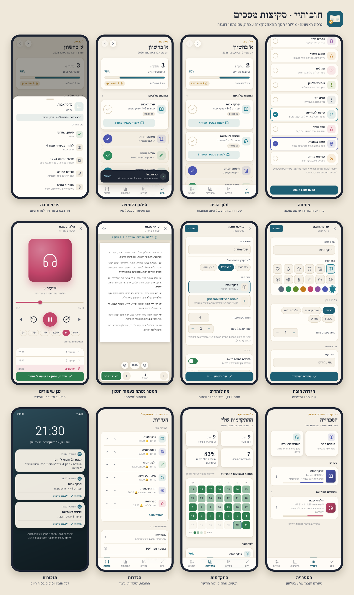

# חובותיי

**האתר עם הסבר לכל כפתור והורדה: https://luach-sport.github.io/chovotai/**

אפליקציית אנדרואיד לחוק הלימוד האישי: בוחרים חובות (דף יומי, משנה יומית, שיעור לשמיעה, כל דבר), מסמנים כל יום מה למדת, ומקבלים תזכורת כשצריך. אפשר לחבר לכל חובה ספר PDF או סדרת שיעורים, ובלחיצה על "ללמוד עכשיו" הספר נפתח בדיוק בעמוד של היום. עובדת בלי אינטרנט.

## הורדה

**[הורדת האפליקציה (chovotai.apk)](https://github.com/luach-sport/chovotai/releases/latest/download/chovotai.apk)**

הקישור תמיד מוביל לגרסה האחרונה.

### התקנה בטלפון
1. פותחים את הקישור **בטלפון** ומורידים את הקובץ.
2. פותחים את הקובץ שירד. בפעם הראשונה הטלפון יבקש לאשר "התקנה ממקור לא ידוע". מאשרים.
3. מתקינים ופותחים. בוחרים חובות ושעה לסיכום היומי.

**עדכון:** מורידים שוב מאותו קישור ומתקינים מעל. החובות, הסימונים והספרים נשמרים.

**שיתוף עם חברים:** הגדרות ← שיתוף האפליקציה. שולחים קישור לאתר עם הודעה קצרה, או את האפליקציה עצמה כקובץ (בבלוטות', בוואטסאפ, במנהל הקבצים), גם בלי אינטרנט.

## אפיון וסקיצות

האפיון המלא, עם צילומי מסך מהאפליקציה: **[docs/SPEC.md](docs/SPEC.md)**

## איך זה בנוי
- `www/`: האפליקציה עצמה (HTML, CSS ו־JavaScript בלי ספריות), כולל גופנים ו־pdf.js, כך שהכל עובד בלי אינטרנט.
- `android-res/`: אייקונים, אייקון התראה ומסך פתיחה.
- `scripts/`: הכנת ה־runtime של Capacitor ותיקון פרויקט האנדרואיד.
- `tools/`: יצירת אייקונים, בדיקות אוטומטיות וצילומי המסך.
- `site/`, `scripts/site/`: האתר (GitHub Pages), בנוי מהערכה המשותפת של Itzko (`luach-sport/itzko`). צילומי המסך נוצרים לבד מהאפליקציה.
- `.github/workflows/build.yml`: כל דחיפה ל־main בונה APK חתום ומפרסמת אותו ב־Releases.
- `signing/release.jks`: מפתח החתימה, מוצפן. הסיסמה שמורה בסוד `CHOVOTAI_KEY_PASS` של הריפו.

רישיונות: pdf.js (Apache 2.0), הגופנים Heebo ו־Frank Ruhl Libre (SIL OFL), סמלים מ־Lucide (ISC).

פותח על ידי Itzko.
