# חובותיי · אפיון גרסה 1.0

**מה זה:** אפליקציית אנדרואיד אישית לחוק לימוד. בוחרים אילו חובות לוקחים על עצמך, באיזו תדירות ומה לומדים בכל פעם. כל יום מסמנים מה הושלם, רואים פס התקדמות, ומקבלים תזכורת למה שעוד פתוח. לכל חובה אפשר לחבר ספר PDF או סדרת שיעורים, ובלחיצה אחת הם נפתחים בדיוק במקום של היום.

**עקרונות:**
- **אופליין מלא.** הכל בתוך האפליקציה: הקוד, הגופנים, מנוע ה־PDF, הספרים והשיעורים. אין שרת, אין חשבון, אין צורך באינטרנט אף פעם.
- **פרטיות.** שום מידע לא יוצא מהטלפון. גיבוי נעשה לקובץ, לפי בקשה.
- **מהיר ביד אחת.** סימון בלחיצה אחת, "ללמוד עכשיו" בלחיצה אחת, וכל פעולה אפשר לבטל מיד.
- **עברית מימין לשמאל**, תאריך עברי ולועזי, ומצב בהיר או כהה לפי הטלפון.

---

## 1. ניווט

ארבע לשוניות בתחתית: **היום · ספרייה · התקדמות · הגדרות**.
מעליהן נפתחים מסכים מלאים (עריכת חובה, קורא הספרים, נגן השיעורים) וחלונות תחתונים (פרטי חובה, הוספת חובה, אישורים). כפתור "חזרה" של הטלפון סוגר קודם חלון, אחר כך מסך, אחר כך חוזר ללשונית "היום".

## 2. פתיחה ראשונה

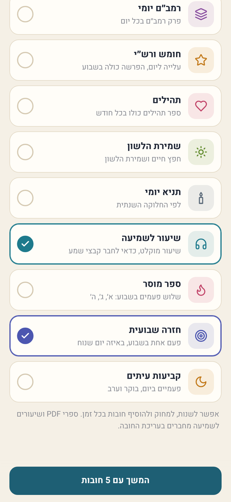
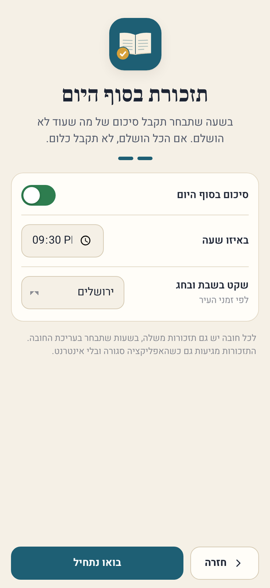

1. **בחירת חובות** מתוך 12 חובות מוכנות (סימון כמה שרוצים): דף יומי, משנה יומית, הלכה יומית, רמב״ם יומי, חומש ורש״י, תהילים, שמירת הלשון, תניא יומי, שיעור לשמיעה, ספר מוסר (א׳ ג׳ ה׳), חזרה שבועית, קביעות עיתים (פעמיים ביום). אפשר גם לדלג.
2. **תזכורת סוף יום:** הפעלה, שעה (ברירת מחדל 21:30) ועיר לזמני שבת.
3. בסיום מתבקשת הרשאת התראות.

## 3. מסך הבית ("היום")

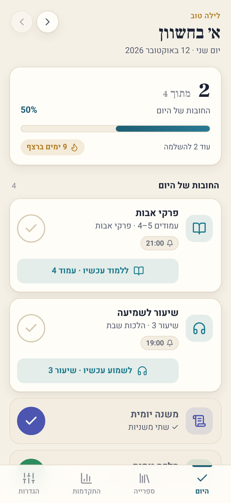
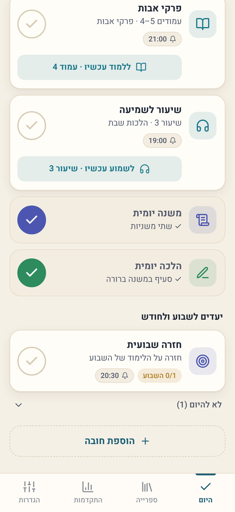
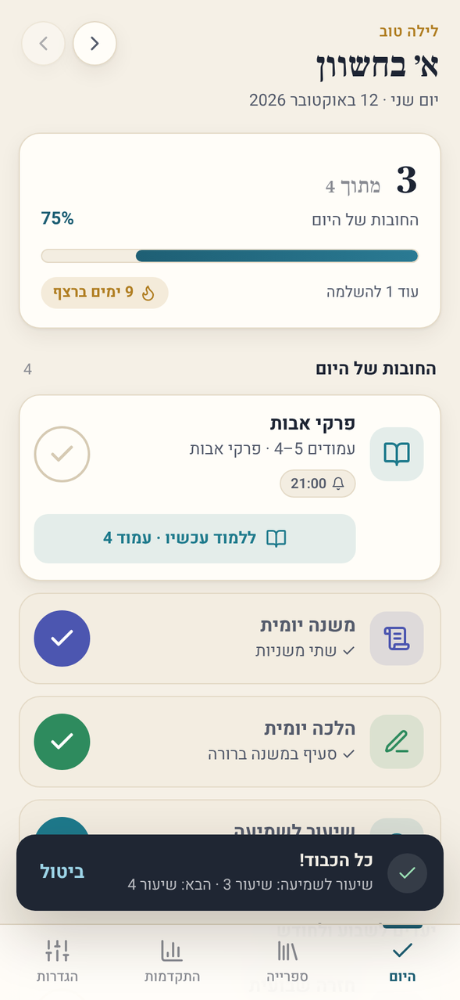

**כותרת:** ברכה לפי השעה, התאריך העברי בגדול, היום בשבוע והתאריך הלועזי. חיצים למעבר ליום הקודם (אפשר לחזור אחורה ולסמן יום שעבר) ובחזרה להיום.

**כרטיס התקדמות:** "2 מתוך 4", אחוז, פס התקדמות שמתמלא במשך היום (ירוק כשהכל הושלם), כמה נשאר, ורצף הימים.

**כרטיס חובה**, מימין לשמאל:
- סמל וצבע של החובה.
- שם, ומה לומדים עכשיו. אם מחובר ספר: "עמודים 4–5 · פרקי אבות". אם מחוברים שיעורים: "שיעור 3 · הלכות שבת". אחרת התיאור שכתבת.
- תגיות: התזכורת הבאה (🔔 21:00), נקודות התקדמות כשיש כמה פעמים ביום, "באיחור של יומיים" בחובה של "כל כמה ימים", תדירות לא יומית.
- **עיגול סימון.** לחיצה מסמנת שלמדת (ובחובה של פעמיים ביום, מראה 1/2). לחיצה על עיגול מלא מבטלת.
- **"ללמוד עכשיו · עמוד 4"** או **"לשמוע עכשיו · שיעור 3"**: פותח ישר את הספר או השיעור במקום הנכון.
- לחיצה על הכרטיס עצמו פותחת את פרטי החובה.

**חלקי המסך:** החובות של היום (מה שהושלם יורד למטה) → "יישר כוח!" כשהכל הושלם → יעדים לשבוע ולחודש → "לא להיום" (מקופל, עם "הבא: מחר / ביום חמישי") → "הוספת חובה".

**אחרי כל סימון** מופיעה הודעה קצרה ("אשריך!", מה נלמד, ומה הבא בתור) עם כפתור **ביטול**.

## 4. פרטי חובה

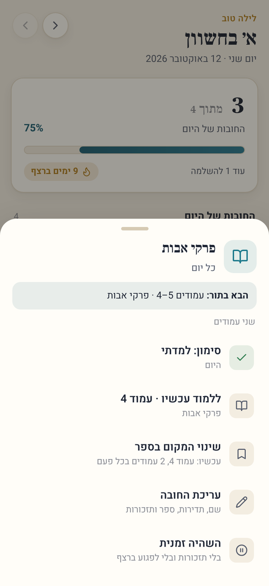

חלון תחתון עם: מה הבא בתור, מה כבר נלמד ביום הזה (עם שעה, והאחרון אפשר לבטל), ופעולות: סימון (גם לימוד נוסף), ללמוד עכשיו, **שינוי המקום בספר** (למשל לקפוץ לעמוד 120), עריכה, והשהיה זמנית (בלי תזכורות ובלי לפגוע ברצף).

## 5. הוספה ועריכה של חובה

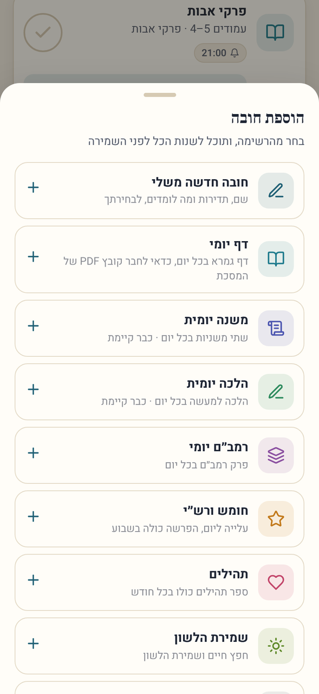
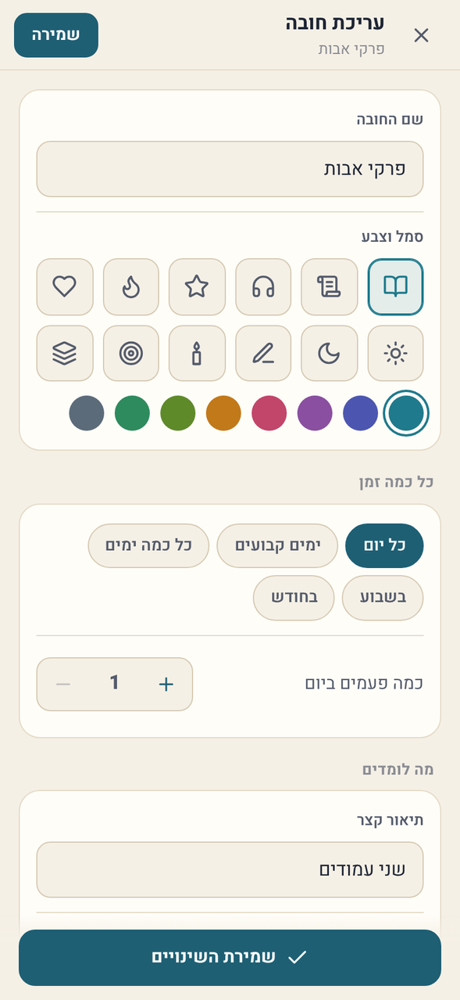
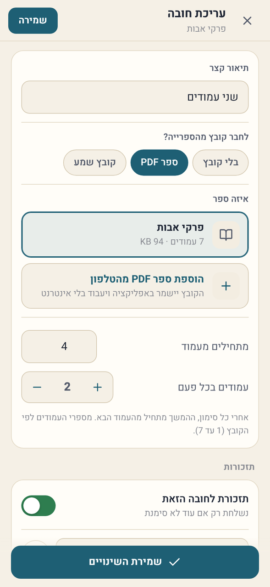

הוספה מתחילה מרשימת החובות המוכנות או מ"חובה חדשה משלי", ותמיד אפשר לשנות הכל לפני השמירה.

| שדה | אפשרויות |
|---|---|
| שם | טקסט חופשי (עד 40 תווים) |
| סמל וצבע | 12 סמלים, 8 צבעים |
| **כל כמה זמן** | **כל יום** · **ימים קבועים** (בוחרים ימים, א׳ עד ש׳) · **כל כמה ימים** (פעם ב־2 עד 60 ימים) · **בשבוע** (1–7 פעמים, באיזה יום שנוח) · **בחודש** (1–30 פעמים, לפי החודש העברי) |
| כמה פעמים ביום | 1–10 (בתדירויות היומיות) |
| מה לומדים | תיאור קצר, ובחירה: בלי קובץ / ספר PDF / קובץ שמע |
| ספר PDF | בחירת ספר מהספרייה (או הוספת ספר חדש ישר מכאן), עמוד התחלה, כמה עמודים בכל פעם |
| קובץ שמע | בחירת סדרה, "שיעורים שלמים" או "מספר דקות", כמות בכל פעם, שיעור התחלה |
| תזכורות | הפעלה, ועד 5 שעות ביום לכל חובה |
| (בעריכה) | השהיה, מחיקה (עם אישור) |

## 6. קורא הספרים

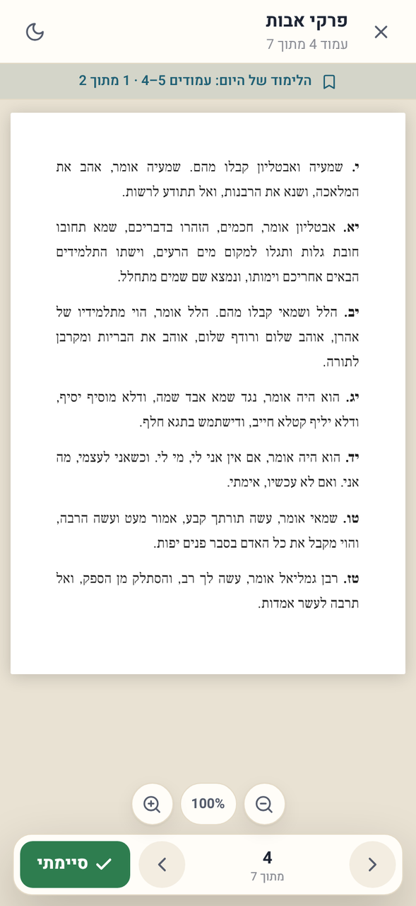
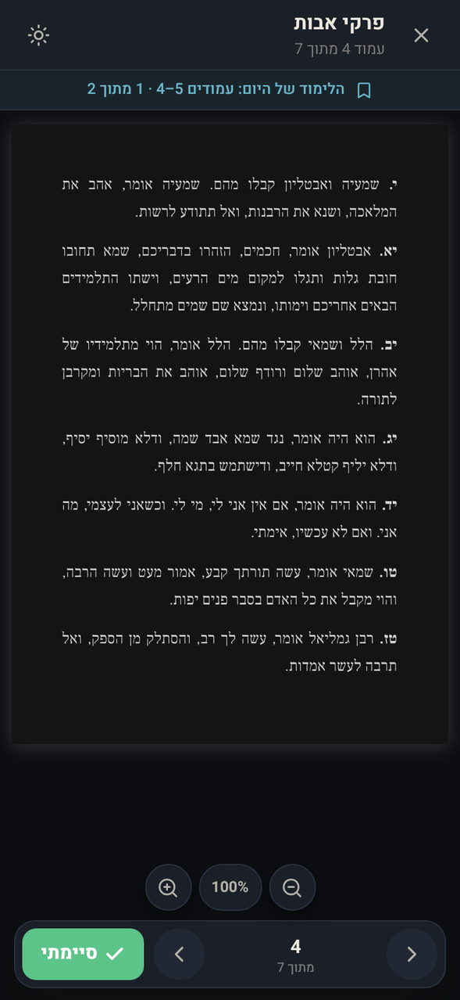

- **נפתח בדיוק בעמוד של היום.** פס עליון מראה "הלימוד של היום: עמודים 4–5 · 1 מתוך 2", ואחרי העמוד האחרון: "קראת את עמודים 4–5. לחץ סיימתי".
- **"סיימתי"** מסמן את החובה ומקדם את הספר: הלימוד הבא מתחיל מהעמוד שאחרי. אם קראת יותר (למשל המשכת עד עמוד 7), ההמשך מתחיל מעמוד 8.
- דפדוף: חצים, או החלקה ימינה לעמוד הבא (כמו בספר עברי). לחיצה על מספר העמוד: מעבר לכל עמוד, או חזרה לעמוד של היום.
- הגדלה: כפתורים, צביטה בשתי אצבעות, או הקשה כפולה.
- **מצב לילה** (כפתור הירח): דף כהה לקריאה בחושך.
- הספר זוכר את העמוד האחרון גם כשנפתח מהספרייה.
- ספרים גדולים (סריקה של מאות עמודים) נטענים בחלקים ישר מהזיכרון של הטלפון, כך שגם קובץ של מאות מגה נפתח מהר.

## 7. נגן השיעורים

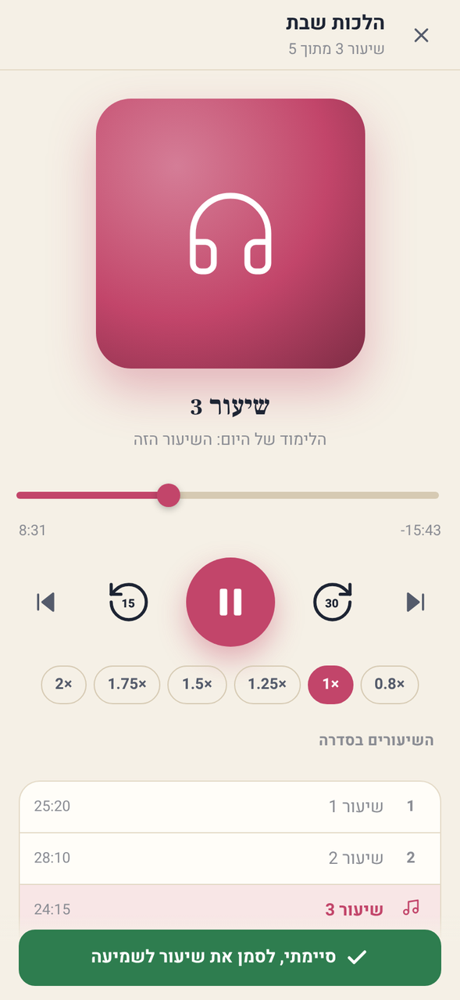

- ממשיך מאיפה שעצרת. כשנפתח מחובה, מראה את המטרה ("הלימוד של היום: השיעור הזה" או "20 דקות").
- 15 שניות אחורה, 30 קדימה, שיעור קודם/הבא, פס מיקום, מהירויות 0.8× עד 2× (נשמרת).
- רשימת השיעורים בסדרה, לחיצה עוברת לשיעור.
- כשמגיעים ליעד של היום מופיע "השלמת את הלימוד של היום!", ו"סיימתי" מסמן ומקדם לשיעור הבא (או לדקה שבה עצרת).
- כשיוצאים מהאפליקציה בזמן שמסך הנגן פתוח, השמע אמור להמשיך. התראה עם כפתורי ניגון כשהמסך כבוי עוד לא קיימת (סעיף 16).

## 8. הספרייה

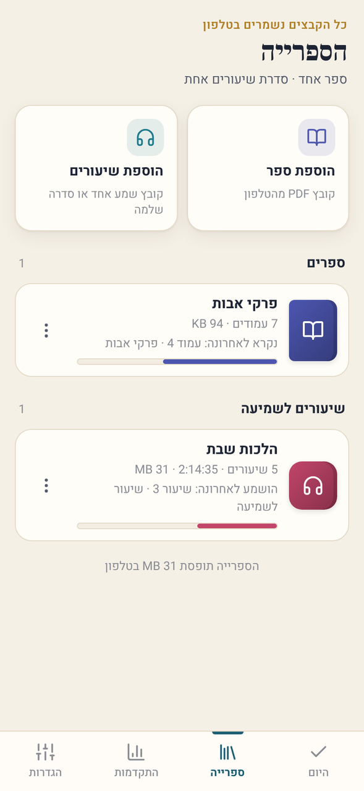

- **הוספת ספר:** בוחרים קובץ PDF מהטלפון. הוא מועתק לאפליקציה (עובד בלי אינטרנט ונשאר גם אם הקובץ המקורי נמחק), ונספרים העמודים.
- **הוספת שיעורים:** בוחרים קובץ שמע אחד או כמה יחד. כמה קבצים הופכים לסדרה אחת, מסודרת לפי השם (שיעור 2 לפני שיעור 10), והשם נקבע לבד ("הלכות שבת").
- לכל פריט: פתיחה, יצירת חובה ממנו, הוספת שיעורים לסדרה, שינוי שם, מחיקה מהטלפון (עם אישור; חובות מחוברות נשארות בלי קובץ).
- מוצג גודל הספרייה בטלפון.

## 9. התקדמות

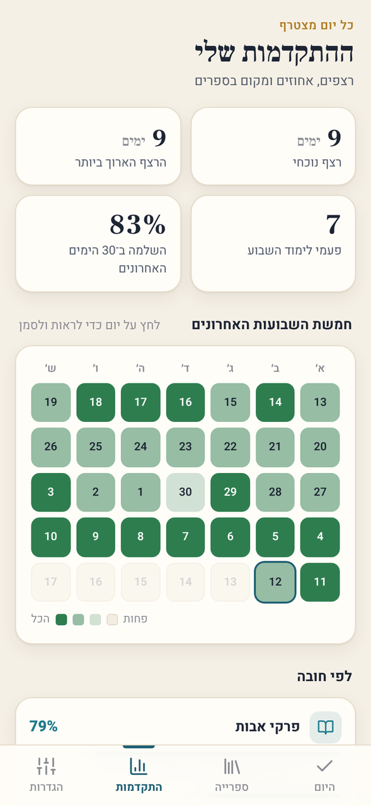
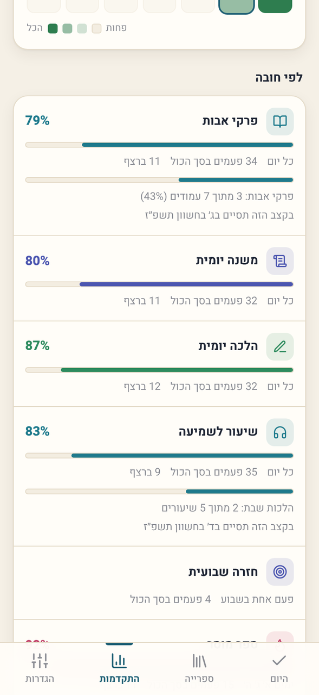

- **רצף נוכחי** ו**הרצף הארוך ביותר** (ימים רצופים שבהם הושלם כל מה שהיה צריך), **פעמי לימוד השבוע**, ו**אחוז השלמה** ב־30 הימים האחרונים.
- **לוח של חמישה שבועות**: כל יום צבוע לפי כמה הושלם. לחיצה על יום פותחת אותו במסך הבית, ושם אפשר לסמן ולתקן.
- **לפי חובה:** אחוז השלמה, כמה פעמים בסך הכול, רצף, ואם מחובר ספר: איפה אתה בו ("3 מתוך 7 עמודים, 43%") ו**מתי תסיים בקצב הזה** (בתאריך עברי).

## 10. תזכורות

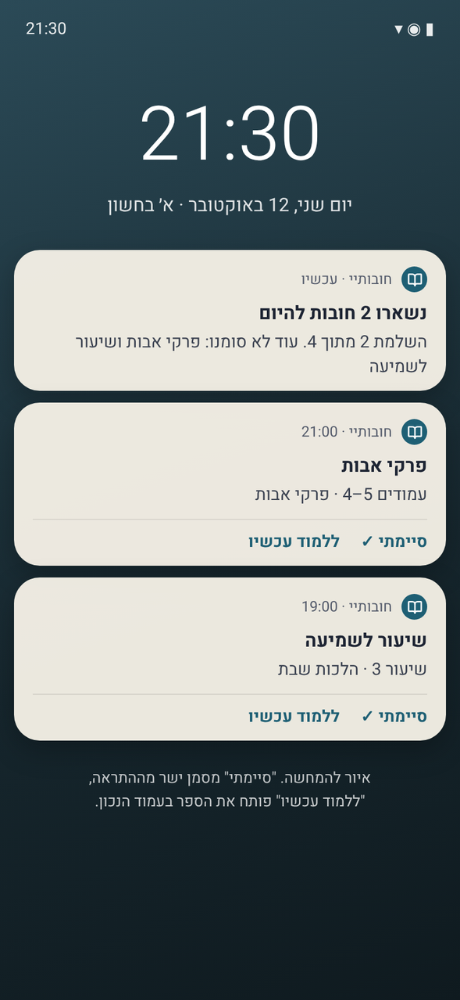

- **לכל חובה** עד 5 שעות ביום. התזכורת נשלחת **רק אם החובה עוד לא סומנה**, ומראה מה ללמוד ("עמודים 4–5 · פרקי אבות").
- כפתורים בהתראה: **"סיימתי ✓"** מסמן בלי לפתוח כלום, **"ללמוד עכשיו"** פותח את הספר או השיעור בעמוד הנכון.
- **סיכום בסוף היום** בשעה שבוחרים: "נשארו 2 חובות להיום. עוד לא סומנו: …". אם הכל הושלם, לא נשלח כלום.
- **שקט בשבת ובחג** (ברירת מחדל): אין התראות מ־45 דקות לפני השקיעה בערב שבת או חג ועד 15 דקות אחרי צאת הכוכבים, לפי העיר (34 ערים בישראל).
- חובה בהשהיה לא שולחת תזכורות. יעד שבועי או חודשי שהושלם מפסיק להזכיר עד התקופה הבאה.
- התזכורות מתוזמנות בטלפון לשבוע קדימה ומתעדכנות בכל סימון, ולכן מגיעות גם כשהאפליקציה סגורה ובלי אינטרנט.

## 11. הגדרות

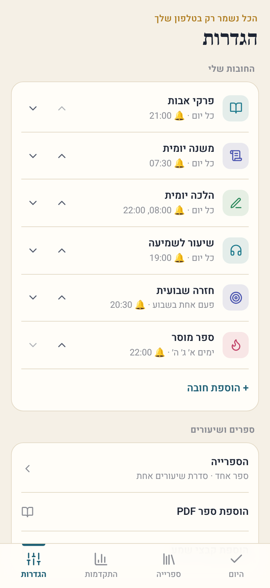
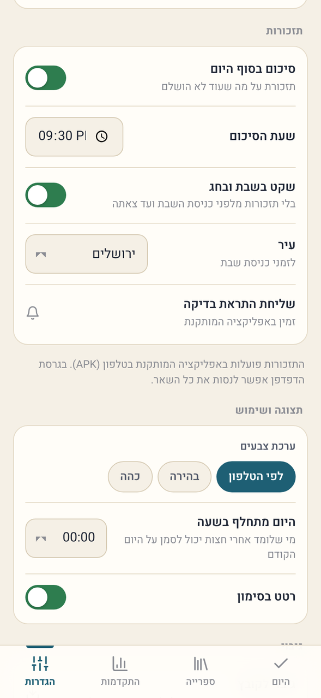
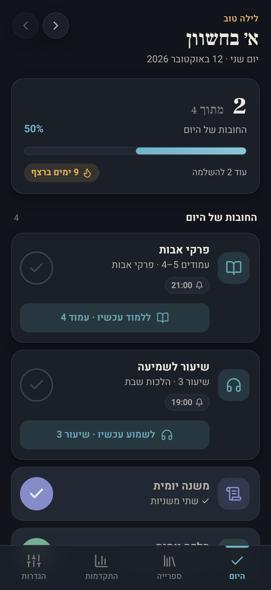

- **החובות שלי:** רשימה עם תדירות ושעות תזכורת, עריכה, שינוי סדר, הוספה.
- **ספרים ושיעורים:** מעבר לספרייה, הוספת PDF, הוספת קבצי שמע.
- **תזכורות:** מצב הרשאה (וכפתור הפעלה אם כבויה), הרשאת שעה מדויקת, סיכום בסוף היום ושעתו, שקט בשבת ובחג, עיר, שליחת התראת בדיקה.
- **תצוגה ושימוש:** ערכת צבעים (לפי הטלפון / בהירה / כהה), **היום מתחלף בשעה** 00:00 עד 04:00 (מי שלומד אחרי חצות מסמן על היום הקודם), רטט בסימון.
- **גיבוי:** שמירה לקובץ (החובות, הסימונים וההגדרות), שחזור מקובץ, מחיקת כל הסימונים.

## 12. כללי חישוב

| נושא | הכלל |
|---|---|
| כל יום | החובה מופיעה בכל יום, X פעמים |
| ימים קבועים | מופיעה רק בימים שנבחרו |
| כל N ימים | מופיעה N ימים אחרי הפעם האחרונה שהושלמה. אם פספסת, היא נשארת עם "באיחור של…" עד שתשלים, ואז הספירה מתחילה מחדש |
| בשבוע / בחודש | מופיעה בכל יום תחת "יעדים לשבוע ולחודש" עד שמגיעים ליעד. שבוע: ראשון עד שבת. חודש: החודש העברי |
| פס ההתקדמות של היום | מה שהושלם מתוך מה שנדרש היום, בחובות היומיות. יעדים שבועיים וחודשיים מוצגים בנפרד |
| רצף | ימים רצופים שבהם הושלם הכל. יום בלי חובות לא שובר את הרצף. היום נספר רק אחרי שהושלם |
| מקום בספר | אחרי "סיימתי": העמוד שאחרי סוף הקטע (או אחרי העמוד שאליו הגעת, אם קראת יותר). ביטול מחזיר את המקום |
| מקום בשיעורים | שיעורים שלמים: מתקדם לשיעור הבא. דקות: נשמרת הדקה שבה עצרת, וממשיכים ממנה |
| סיום משוער | עמודים שנשארו, חלקי עמודים בכל פעם, חלקי מספר הפעמים ביום לפי התדירות |

## 13. נתונים, אופליין ופרטיות

- החובות, הסימונים וההגדרות נשמרים בזיכרון האפליקציה. הספרים והשיעורים נשמרים במסד הקבצים של האפליקציה. כלום לא נשלח לשום מקום.
- האפליקציה לא משתמשת באינטרנט לשום פעולה. בחירת קבצים נעשית דרך בוחר הקבצים של אנדרואיד.
- **הגיבוי לקובץ לא כולל את הספרים עצמם** (הם יכולים להיות גדולים מאוד). אחרי שחזור בטלפון חדש, ספר שחסר יבקש "בחירת הקובץ מחדש" ויחזור למקום שבו היית.
- הסרת האפליקציה מוחקת את כל הנתונים. עדכון (התקנה מעל) שומר הכל.

## 14. בנייה, התקנה ועדכונים

- כל דחיפה לענף `main` בונה ב־GitHub Actions קובץ APK חתום ומפרסמת אותו ב־Releases. הקישור הקבוע:
  `https://github.com/luach-sport/chovotai/releases/latest/download/chovotai.apk`
- החתימה קבועה (המפתח בריפו, הסיסמה בסוד `CHOVOTAI_KEY_PASS`), ולכן כל גרסה חדשה מותקנת מעל הקודמת בלי למחוק נתונים.
- טכנולוגיה: HTML, CSS ו־JavaScript בלי ספריות, עטוף ב־Capacitor 7 לאנדרואיד. pdf.js מוטמע לקריאת PDF. התראות מקומיות עם שעון מדויק, ומשוחזרות אחרי הפעלה מחדש של הטלפון.
- דרישות: אנדרואיד 7 ומעלה (Android System WebView מעודכן).

## 15. בדיקות שבוצעו בגרסה הזאת

בדיקה אוטומטית בדפדפן (`tools/test_app.py`) על האפליקציה עצמה: פתיחה ובחירת חובות, סימון וביטול, הוספת PDF וספירת עמודים, הוספת סדרת שמע ושמה, חיבור ספר לחובה בעריכה, פתיחת הספר בעמוד הנכון, החלקה לעמוד הבא, "סיימתי" שמקדם את הספר וביטול שמחזיר, ספר של 25MB שנטען בחלקים ומגיע לעמוד האחרון, הגדלה, נגן שנפתח בשיעור הנכון ו"סיימתי" שמקדם, כללי התדירויות (כל 3 ימים, ימים קבועים, יעד שבועי), לוח התזכורות (בלי התראות בשבת, מזהים ייחודיים), גיבוי ושחזור בלי אובדן, ובלי שגיאות בקונסול.

## 16. לא בגרסה הראשונה (רעיונות להמשך)

- התראה קבועה עם כפתורי ניגון כשהמסך כבוי, ומסך שלא נכבה בזמן קריאה.
- סימניות והערות בתוך הספר, וחיפוש טקסט ב־PDF.
- לוח הלימוד המסורתי (דף יומי לפי הסדר העולמי, רמב״ם יומי, חלוקת תהילים) שמחשב לבד מה לומדים היום.
- גיבוי שכולל גם את הספרים, וסנכרון בין מכשירים.
- ווידג'ט למסך הבית של הטלפון.
